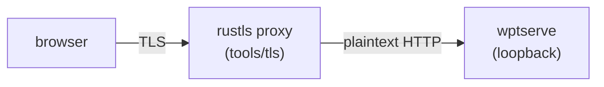

# RFC 247: Optional TLS test server

## Summary

This RFC proposes adding an optional TLS test server to wpt, using [rustls](https://github.com/rustls/rustls) and shipped as a static Rust binary. It enables testing of TLS and TLS adjacent behavior below HTTP, such as protocol versions, cipher suites, ALPN, client certificates, and certificate validation edge cases.

It runs as a proxy server in its own process. It terminates TLS using a declarative profile selected by SNI. It also terminates and translates HTTP/2 to HTTP/1.1 and forwards plaintext HTTP to a `wptserve` listener. The design requires `wptserve` to honor `X-Forwarded-Proto` from the proxy so origins stay `https`. `wptserve` is otherwise unchanged. The design skips affected tests when the binary is absent.

The first version supports HTTP/1.1 requests with `Content-Length` bodies and simple HTTP/2 requests. HTTP/2 request and response streaming, flow control, trailers, and concurrent streams are later work.

## Details

### Motivation

WPT cannot currently test TLS behavior. The `wptserve` HTTPS module (`tools/wptserve/wptserve/sslutils`) generates certificates with the `openssl` cli and terminates TLS with CPython's `ssl` module, an OpenSSL wrapper. The current implementation is limited because it cannot control the TLS state machine and crypto. A test cannot ask for an expired certificate, a required client certificate, only TLS 1.2, or a specific cipher. Existing vendor suites (BoringSSL `ssl/test/`, NSS gtests) cover byte level conformance but are not WPT.

This issue is tracked as [wpt#20159](https://github.com/web-platform-tests/wpt/issues/20159) and [crbug 489734010](https://issues.chromium.org/issues/489734010).

### Goals and scope

The main goal is to test web observable behavior from real browsers. This includes success and failure, errors, negotiated versions, ciphers, ALPN, and timings.

No Rust toolchain should be required of users. To ensure that a prebuilt binary is viable, we also need declarative properties per test. It should have no impact on existing tests and be off by default.

The first version targets HTTP/1.1 requests with `Content-Length` bodies and HTTP/2 requests without bodies. Full HTTP/2 streaming, chunked HTTP/1.1 request bodies, timeouts, and backend error responses are later work.

Some desired features are left as later work once the basic infrastructure works. These include 0 RTT, session resumption, OCSP and CRL, ECH, record layer faults, and extended CONNECT. The only upstream `rustls` work in scope is a fault injection hook.

Features above HTTP (such as HSTS and mixed content) are beyond this proposal, and so is byte level conformance.

There is a case for replacing or rewriting `wptserve` HTTP handling, but it is a far bigger task. Instead, we opted for a modular design that supports this feature without changing the existing infrastructure. The tool is not a general purpose proxy. It is meant for use only in wpt.

RFC 42 split the infrastructure from the API and promised the API as later work. We merge both here because the declarative interface makes a prebuilt binary viable, and we want to validate the whole path before asking for approval. If reviewers prefer one piece at a time, this can be split into an infrastructure RFC and an interface RFC.

### Architecture



The server is a standalone proxy. Whether it is a subprocess of `wpt serve`, and how it is monitored and terminated, is an integration detail (see [Integration](#integration)), not part of the test visible contract.

The proxy terminates TLS. It forwards HTTP/1.1 requests with hop by hop headers removed. It adds `X-Forwarded-Proto: https` and removes any client supplied value. It adds `Connection: close` so the response read ends at EOF. It advertises `h2` and translates HTTP/2 requests to HTTP/1.1. The prototype handles simple HTTP/2 requests without a request body. A full implementation needs request and response streaming, flow control, trailers, and concurrent streams.

The tool uses a JSON config read once at startup. One listener can serve many SNI profiles. The proxy returns `X-Negotiated-Version`, `X-Negotiated-Cipher`, and `X-Negotiated-ALPN` response headers for positive assertions. A cross origin test must expose these headers with `Access-Control-Expose-Headers`. ALPN and timing are also available via resource timing.

For certificates, the prototype uses a generated matrix in `tools/certs/tls`. The WPT CA has name constraints, so profile names must stay inside the permitted names. The current matrix uses `www`, `www1`, `www2`, and `not-web-platform.test` names. The default profile uses the pregenerated `web-platform.test` leaf so Chrome can use its existing SPKI exception. Generated leaves are signed by the WPT CA. Firefox installs the CA via certutil. Chrome currently only accepts the pregenerated leaf, so profile and negative certificate tests skip on Chrome. A Chrome path requires the harness to trust the WPT CA, or a dedicated TLS CA, without disabling validation. Negative leaves use distinct keys. Negative tests run only when the harness can guarantee validation. The WPT CA expires on 2027-08-30, so the matrix must be regenerated when the CA is renewed. The not yet valid leaf is time bounded.

Profiles are selected by SNI. A profile name must be a host that the certificate covers and the CA permits. `rustls` selects a `ServerConfig` per SNI. Each profile chooses its own ALPN list, so a profile that should not use HTTP/2 advertises only HTTP/1.1. For example, `https://www.{{host}}:{{ports[tls][0]}}/` selects the `www` profile.

Tests that need the server declare it with a marker (`<meta name="tls-server" content="true">` in HTML, `// META: tls-server=true` in JS). The manifest records the marker and wptrunner skips those tests unless `--enable-tls-server` is passed, so an absent server yields skips rather than failures. This follows the marker approach in RFC 42. This marker is planned but not implemented in the prototype. Until it lands, TLS tests run only with `--enable-tls-server`.

### Design decision: declarative SNI profiles

The standalone binary depends on configuration being data rather than code. A profile is a named set of TLS parameters selected by SNI: certificate, key, version bounds, cipher suites, ALPN list and client authentication. The server reads one JSON config at startup and picks a profile per connection. This is the central decision of this proposal, and it is what makes shipping a binary viable. With no per connection scripting there is no handler bridge, and users need neither Python nor Rust at run time.

The tradeoff is expressiveness. Tests cannot compute per connection behavior, unlike the `.quic.py` custom handlers in [RFC 42](https://github.com/web-platform-tests/rfcs/blob/master/rfcs/quic.md). New behavior must map onto an existing profile field, or the field must be added to the server. We consider this acceptable for TLS testing, where the interesting variation is a bounded set of protocol parameters, and scripting would rule out prebuilt binaries.

### Property interface

There is a declarative JSON interface to configure the server. It is a list of listeners, each with multiple SNI profiles. Every profile field except `cert` and `key` is optional. `client_ca` is required when `client_auth` is `request` or `require`. Unknown fields are rejected. Paths should be absolute. There are no per connection scripts, unlike [RFC 42](https://github.com/web-platform-tests/rfcs/blob/master/rfcs/quic.md).

```json
{
  "listeners": [{
    "listen": "127.0.0.1:8447",
    "backend": "127.0.0.1:8000",
    "provider": "aws-lc-rs",
    "default_profile": "default",
    "profiles": {
      "default": {
        "cert": "/path/to/web-platform.test.pem",
        "key": "/path/to/web-platform.test.key",
        "min_version": "1.3",
        "max_version": "1.3",
        "alpn": ["h2", "http/1.1"]
      },
      "www": {
        "cert": "/path/to/www.pem",
        "key": "/path/to/www.key",
        "min_version": "1.3",
        "max_version": "1.3",
        "cipher_suites": ["TLS13_AES_128_GCM_SHA256"],
        "alpn": ["h2", "http/1.1"],
        "client_auth": "none"
      }
    }
  }]
}
```

`provider` is optional and accepts `aws-lc-rs` or `ring`. The default is `aws-lc-rs`. `min_version` and `max_version` accept `1.2` or `1.3`. The default range is `1.2` to `1.3`. `client_auth` accepts `none`, `request`, or `require`. `alpn` is an ordered list. `cipher_suites` uses rustls or IANA names.

### Integration

- `wpt serve`: new `tls` port and `--tls-server`. Writes the config, starts the server in its own process, waits for readiness, and terminates it on shutdown. The port is exposed as `{{ports[tls][0]}}`.
- `wpt run`: the same via `wptrunner` (`--enable-tls-server`, a `tls` port and `tls_server` passed to `serve.start`).
- Binary located via `WPT_TLS_SERVER`, or downloaded instead (see Distribution).
- The `X-Forwarded-Proto` change in `wptserve` is a small independent change that can be reviewed separately from the server. It is not implemented in the prototype.
- The skip marker is not implemented in the prototype.

### Distribution

We support two paths and expect different consumers to pick different ones.

Prebuilt binaries are the default for users. This RFC proposes extending `wpt install` with a `tls-server` product (`wpt install tls-server`), used in a similar way to other webdrivers. Passing `--tls-server` or `--enable-tls-server` installs it automatically when missing (prompting the user), and `WPT_TLS_SERVER` overrides the binary path.

Building from source is supported for browser vendors and local development. Most vendors already have a Rust toolchain in their pipelines, and building from source avoids asking them to accept prebuilt binaries in their build and distribution process. `cargo build --release` builds the crate. `aws-lc-rs` needs `cmake` and `nasm` at build time. `ring` is an optional provider for builds that cannot use `aws-lc-rs`.

The prototype points at a placeholder repository and has no releases. Hosting, release automation, and checksums are unresolved. `wpt install tls-server` is not usable until that lands. Release checksums are SHA-256 siblings fetched from the same host. Signing and provenance are unresolved.

We lean towards source builds as the primary path for vendors, with prebuilts as a convenience for local use, but we want to confirm that before finalizing this RFC. We want to know whether vendors can consume a prebuilt artifact (for example via cipd or Taskcluster), whether they would build from source, and what licensing or provenance constraints apply. Servo's GStreamer setup, which supports both system libraries and downloaded prebuilts, is a useful precedent.

Hosting can start in a maintainer owned public repository as an experiment, then move to a wpt managed location once accepted. Consumers can mirror the artifacts. Releases are pinned and built per target, each published with a checksum.

### Security

`X-Forwarded-Proto` should only be honored from the loopback proxy, otherwise clients could spoof the scheme or origin. The proxy should only bind loopback. The generated config binds loopback, but the binary does not enforce it yet. Enforce it before production.

The proxy strips client supplied `X-Forwarded-Proto` and hop by hop headers on HTTP/1.1 and HTTP/2. Timeouts and header size limits are not implemented yet.

The WPT CA is test only and adds no production trust. It has name constraints and expires on 2027-08-30. A dedicated TLS CA is an option if the WPT CA constraints become a burden.

Prebuilt binaries should come from pinned and trusted sources, with checksums verified on download. Signing is unresolved.

### Prototype

The prototype is on branch `tls-rfc-prototype`. It includes a Rust crate (`tools/tls`), a certificate matrix, and the wiring for `wpt serve` and `wpt run`. Rust and installer tests pass. The three basic `tls/` tests pass on Chrome. Profile and negative certificate tests skip on Chrome because Chrome only trusts the pregenerated leaf. Firefox was not verified in the development sandbox.

Known gaps in the prototype:

- HTTP/2 request bodies are dropped, responses are buffered, streams are serialized, and the I/O is a polling shim.
- HTTP/1.1 supports only `Content-Length` request bodies. Chunked bodies, `Expect: 100-continue`, backend error responses, timeouts, and header limits are missing.
- `wptserve` `X-Forwarded-Proto` is not implemented. The test only observes the forwarded header.
- The skip marker is not implemented.
- Chrome CA trust and the Firefox validation gate are not implemented.
- The certificate matrix uses WPT CA permitted names. The WPT CA expiry and the time bounded not yet valid leaf need a rotation plan.
- `localhost` is not allowed by the WPT CA, so the prototype does not ship a localhost config. Use a hosts file setup or a dedicated TLS CA.
- Prebuilt hosting, release automation, and checksums are placeholders.
- The binary does not enforce loopback binding and has no timeouts or header limits.
- WebSocket upgrades are not supported and should be scoped out.

## Risks

One of the main concerns in #20159 is ownership and maintenance. We propose Igalia to maintain the Rust crate and the integration with WPT, with @eerii as the main contact. This follows RFC 42 and RFC 85, which name teams rather than individuals. Vendor coordination is still an ongoing burden, especially for binary distribution.

The prototype crate uses `aws-lc-rs` as a crypto library, which needs `cmake` and `nasm` at build time. It supports post quantum crypto, which is beneficial. The prebuilt binaries hide these requirements for end users. It is worth investigating how this affects the vendor build process, and whether it is worth replacing this library or offering `ring`.

The largest new component is HTTP/2 termination, and it is difficult to get right because it involves async I/O and stream management. The prototype proves the model for simple requests, but not for request bodies, streaming, flow control, trailers, or concurrent streams.

Negative certificate tests need harness enforced validation, such as `certutil`, and are skipped otherwise. The prototype uses a positive control to skip when the harness does not trust the WPT CA. A full implementation needs a stronger validation check.

The WPT CA name constraints and expiry limit the certificate matrix. A dedicated TLS CA may be simpler for negative tests and profile names, at the cost of a second CA to install in each browser.

## Alternatives

- Go: it was proposed before, and `crypto/tls` meets the technical criteria, but it is not as commonly supported in browser CI.
- Python: there is still no production ready Python TLS that can cover the wide needs of this proposal.
- In process Rust (PyO3): `wptserve` is tightly coupled with `sslsocket` and `asyncio`, which makes it complicated.
- Static binary vs wheels: one artifact per platform, no handler bridge, fewer vendor moving parts.

## Unresolved

- Eventual hosting location for the release artifacts.
- Certificates: keep the WPT CA with permitted names, or use a dedicated TLS CA. Cert rotation and the WPT CA expiry need a plan.
- HTTP/2 backend: serialize streams per connection or use concurrent connections.
- Record fault hook: upstream first or vendoring.

## References

- [wpt#20159](https://github.com/web-platform-tests/wpt/issues/20159)
- [crbug 489734010](https://issues.chromium.org/issues/489734010)
- [RFC 42](https://github.com/web-platform-tests/rfcs/pull/42) (optional QUIC and WebTransport server)
- [RFC 85](https://github.com/web-platform-tests/rfcs/pull/85) (WebTransport over HTTP/3 test server)
- [RFC 67](https://github.com/web-platform-tests/rfcs/pull/67) (WebSocket over HTTP/2)
- [RFC 216](https://github.com/web-platform-tests/rfcs/pull/216) (second WebTransport server)
- [rustls](https://github.com/rustls/rustls)
- [aws-lc-rs](https://github.com/aws/aws-lc-rs)
